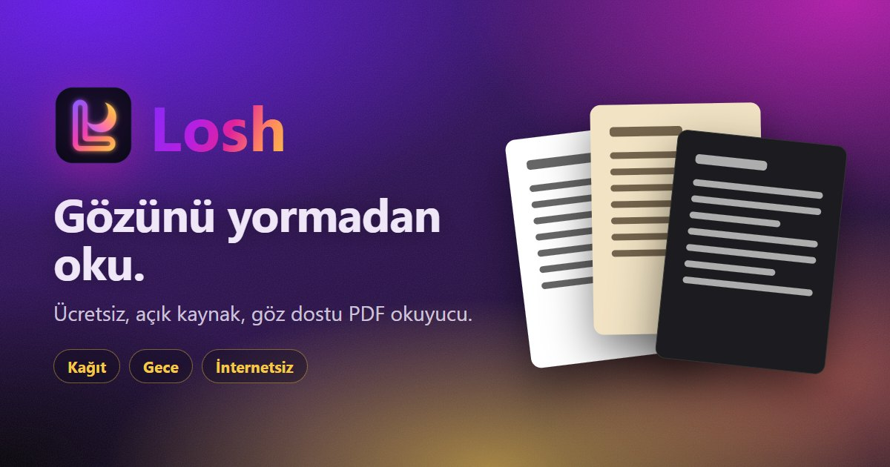

<p align="center">
  
</p>

# Losh

**Read without tiring your eyes.** Losh is a free and open-source reader that shows PDF books in paper or night tones. No sign-up, no ads; your PDFs never leave your device.

**Try it now:** https://loshreader.vercel.app · [Türkçe](README.md)

## Why Losh?

**The problem:** reading PDF books for a long time tires and hurts the eyes. A bright white page and harsh screen light make it worse.

**The goal:** to let everyone, especially students and book lovers, read their PDFs without straining their eyes, for free and safely.

**The name:** *loş* is Turkish for dim, soft, restful light. Losh's pages and its interface are designed to feel exactly like that.

> I made Losh first for myself, as someone whose eyes got tired reading PDF books, and then for everyone with the same problem. — Kubilay

### Our promise

- **Always free:** no paid version, subscription or ads. Only optional donations.
- **Your file stays with you:** PDFs are never uploaded to any server; no tracking, cookies or analytics.
- **Works offline:** read on the subway, on a plane, anywhere without internet.
- **Open source:** all of the code is here, so anyone can check what we say.

## What it does

- **Eye-friendly modes:** Normal, Paper, Night and Dark sepia, plus warm light, brightness and contrast. In night mode, photos keep their natural colours.
- **Fit text:** drops the empty page margins and enlarges the text to the width of the screen, so on a phone you read without scrolling sideways.
- **Reading mode:** on a phone, tap the page once and the menus go away.
- **Highlighter:** mark what matters in 4 colours with the pen in the bottom corner. Even a rough swipe snaps to the lines and never spills over; marks are kept with the book on your device.
- **Pick up where you left off:** remembers your page in every book and, if you like, keeps books on your device (**Recently read**).
- **Eye breaks (20-20-20):** if you want, every 20 minutes it guides a 20-second break: look far away, then blink.
- **Works everywhere:** add it to the home screen on iPhone, Android or a computer; after the first visit it works offline.
- **Five languages:** Türkçe, English, Español, Français, Русский.

Install and how-to guides are on the site: [Install](https://loshreader.vercel.app/#install) · [How to use](https://loshreader.vercel.app/#guide) · [FAQ](https://loshreader.vercel.app/#faq)

## Privacy

Losh collects nothing: no server, accounts, cookies, ads or analytics. PDFs are opened inside the browser; settings and kept books stay on your device only. Details: [privacy policy](https://loshreader.vercel.app/privacy/).

## Development

Requires [Node.js](https://nodejs.org) 22 or newer.

```sh
npm install        # install dependencies (once)
npm run dev        # open the site: http://localhost:5173 (welcome) → /app/ (reader)
npm test           # unit tests
npm run typecheck  # TypeScript type check
npm run build      # build (apps/web/dist)
npm run test-pdf   # generate a 500-page test book (test-book.pdf)
```

Every update to `main` is published on Vercel automatically. Manual test checklist (Turkish): [docs/elle-test-listesi.md](docs/elle-test-listesi.md).

### Layout

```
apps/web          website: welcome (/), reader (/app/), privacy (/privacy/), service worker
packages/core     modes, filters, settings, translations, eye break timer (plain TypeScript, tested)
packages/viewer   pdf.js based viewer and its interface (Preact)
scripts/          helper scripts
docs/             plan, phase reports, test checklists (Turkish)
```

Built with TypeScript, [Preact](https://preactjs.com), [pdf.js](https://mozilla.github.io/pdf.js/), Vite and Vitest.

## Support

Losh is completely free. A GitHub Sponsors link for supporting its development is coming soon. For a bug or an idea, [open an issue](https://github.com/Kubilay1876/Losh/issues).

## License

[MIT](LICENSE) · Third-party licenses: [THIRD_PARTY_NOTICES.md](THIRD_PARTY_NOTICES.md)

Made by Kubilay Ç. ([@Kubilay1876](https://github.com/Kubilay1876))

Losh is a reading aid, not a medical product. If your eye pain continues, see an eye doctor.
